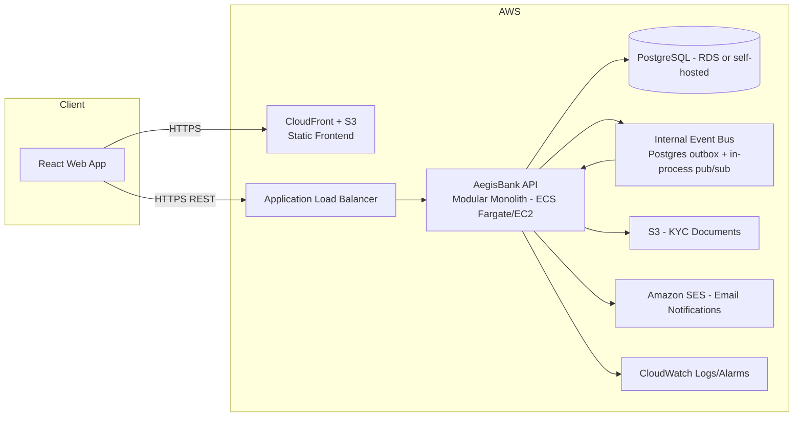
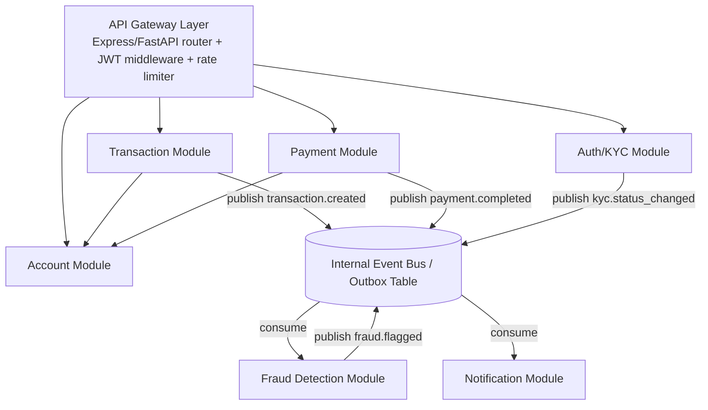
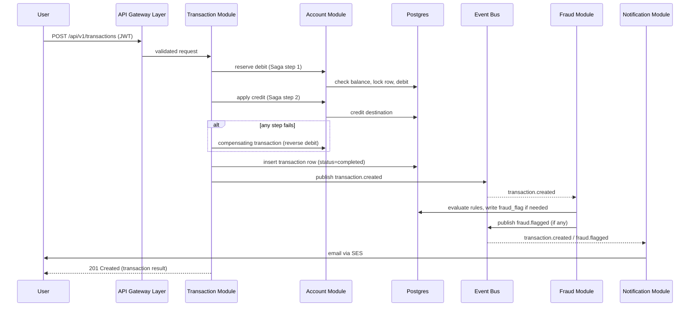
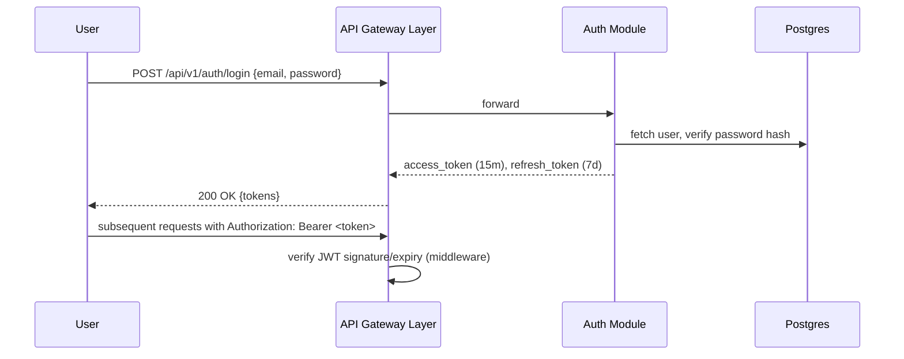
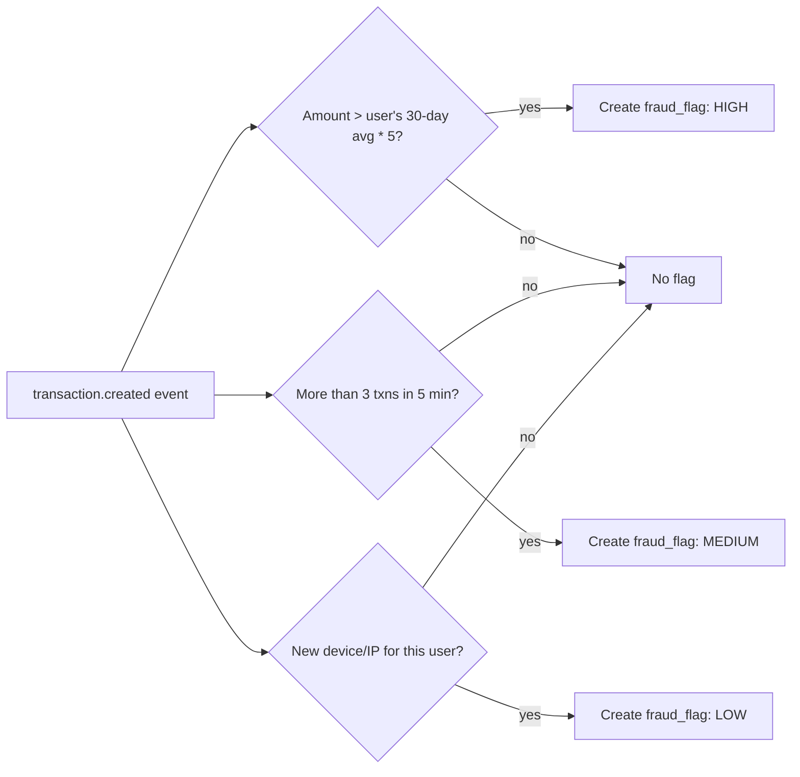
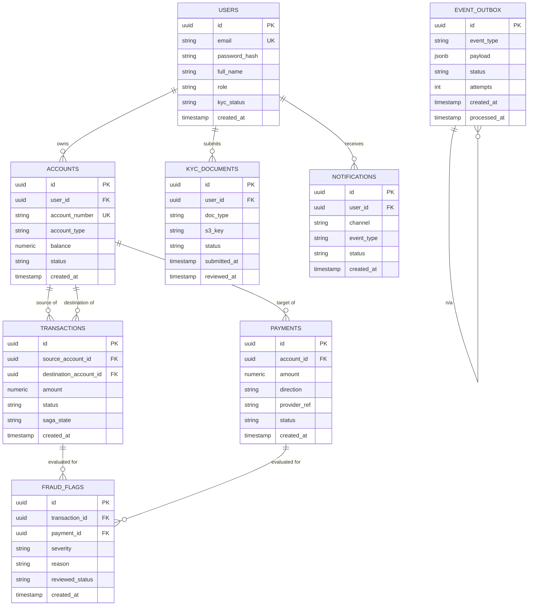

# DOCUMENT 1 — SYSTEM & ARCHITECTURE SPECIFICATION
## AegisBank — Cloud-Native Digital Banking Platform (Student/Demo Build)

> **Scope note (ARCHITECTURE DECISION #0):** The source report specifies Kubernetes + Kafka + full
> microservices with per-service databases. For a student/demo project this is massively over-engineered
> (cost, ops burden, deployment time all explode; VIT-level demo does not need multi-week K8s ops).
> We preserve every *logical* boundary the report defines (Auth/KYC, Account, Transaction, Payment,
> Fraud, Notification) as **separate backend modules inside one modular monolith**, communicating
> in-process via an internal event bus (simple pub/sub / outbox pattern), with **one PostgreSQL
> database using separate schemas per module** (not literally separate DBs) to keep data ownership
> boundaries clean without the operational cost of polyglot persistence. This is deployable on a single
> low-cost AWS compute unit. Document 3 also describes the scale-up path back to ECS+SQS/EventBridge or
> EKS+MSK if this were ever a real product. This decision is preserved throughout; do not reintroduce
> Kubernetes/Kafka without re-justifying cost.

---

## 1. Project Overview

**Problem:** Traditional monolithic core banking systems are hard to scale and risky to update.

**Objective:** Build AegisBank, a system that logically decomposes banking into independent
capabilities (accounts, transactions, payments, auth/KYC, fraud detection, notifications) connected
via events rather than tight coupling, demonstrating cloud-native design principles at low cost.

**Scope (demo-realistic):**
- User registration, login (JWT), basic KYC document upload + manual/simulated approval
- Account creation, balance view, statements
- Internal fund transfers between AegisBank accounts (Saga-style two-step balance update)
- Simulated external "payment rail" (mocked UPI/card top-up) decoupled via the event bus
- Rule-based fraud checks (velocity, large-amount, new-device) run asynchronously post-transaction
- Email/console notifications on transaction, fraud-flag, KYC-status-change events
- Admin view for fraud review

**Out of scope (explicitly, to avoid overengineering):** real payment gateway integration, real SMS
gateway (mocked), multi-currency, regulatory reporting, high-availability multi-region, Kubernetes,
Kafka, distributed tracing infrastructure (basic structured logs + CloudWatch instead).

**Users:** Customer, Admin/Fraud Analyst.

**Major capabilities:** AuthN/KYC, Account mgmt, Transactions, Payments (mock), Fraud detection,
Notifications, Event bus (internal).

---

## 2. Requirements Extraction

### Functional Requirements

| ID | Requirement | Source/Reason | Priority | Implementation |
|----|-------------|----------------|----------|-----------------|
| F1 | User can register and log in (JWT) | Report: Auth/KYC service | Must | Auth module |
| F2 | User can submit KYC document; status tracked (pending/approved/rejected) | Report: KYC checks | Must | Auth/KYC module |
| F3 | User can create/view accounts and balances | Report: Account service = system of record | Must | Account module |
| F4 | User can transfer funds between accounts | Report: Transaction service, Saga pattern | Must | Transaction module |
| F5 | Transfer publishes a `transaction.created` event | Report: event-driven | Must | Internal event bus |
| F6 | External payment (mock top-up) processed async, decoupled from ledger | Report: Payment Service via event bus | Must | Payment module |
| F7 | Fraud engine flags suspicious transactions (velocity, amount, new device) | Report: Fraud Detection Service | Must | Fraud module (event consumer) |
| F8 | User/admin notified on key events | Report: Notification Service | Should | Notification module (event consumer) |
| F9 | Admin can view flagged transactions and mark reviewed | Implied by fraud detection | Should | Admin API |
| F10 | Full request/transaction audit log | Report: audit trail for banking | Should | Structured logs table |

### Non-Functional Requirements

| ID | Requirement | Priority | Implementation |
|----|-------------|----------|-----------------|
| N1 | HTTPS everywhere | Must | ALB/CloudFront + ACM cert |
| N2 | Passwords hashed (bcrypt/argon2), JWT short-lived + refresh | Must | Auth module |
| N3 | p95 API latency < 500ms under demo load | Must | Simple Postgres + indexed queries |
| N4 | System recoverable from crash (stateless app tier, managed DB) | Must | Stateless containers, RDS/managed Postgres |
| N5 | Monthly cost near-zero when idle, low under demo load | Must | Serverless/small always-on tier, see Doc 3 |
| N6 | Basic observability (logs, health checks) | Should | CloudWatch Logs + `/health` endpoint |

### Constraints
- Team is student-scale; must be buildable/deployable by one AI coding agent without a DevOps team.
- Budget: near-₹0 at idle, low cost (≤ ₹1,500–2,000/month, ~$18–24) under light demo traffic.
- No real banking license/compliance requirement — this is a simulation, not a regulated product.

### Assumptions (see also "Open Issues" in Doc 2/3)
- A1: "Payments" = simulated top-up/withdrawal via a mock external API, not a real payment gateway.
- A2: KYC document check is simulated (file uploaded + stub "auto-approve after N seconds" or manual
  admin approval), not real identity verification.
- A3: Single currency (INR), single region deployment.
- A4: Fraud rules are simple threshold rules, not ML — explicitly per report's own permission to use
  deterministic logic where sufficient (Section 8 of the master prompt).

---

## 3. System Architecture

### 3.1 High-Level Architecture



### 3.2 Component Architecture (logical modules inside the monolith)



### 3.3 Request Flow (fund transfer)



### 3.4 Authentication Flow



### 3.5 AI/ML / Fraud Inference Flow

No LLM/ML model is used (per ARCHITECTURE DECISION: deterministic rules are sufficient — see Section 8).



### 3.6 Deployment Architecture
See Document 3 for full detail. Summary: single ECS Fargate (or single EC2) service running the
monolith container, RDS Postgres (or Postgres on the same EC2 for absolute minimum cost), S3 for
KYC file storage, CloudFront+S3 for the static frontend, SES for email.

---

## 4. Technology Stack

| Layer | Choice | Why required | Why selected | Alternatives considered | Cost impact | Complexity impact |
|---|---|---|---|---|---|---|
| Backend language/framework | Node.js + Express (TypeScript) | REST API, JWT, business logic | Fast to build, huge ecosystem, easy for AI coding agent to scaffold, cheap to run | Python/FastAPI (equally valid — pick one) | Low | Low |
| Database | PostgreSQL | Relational integrity for money/ledger data | ACID transactions essential for balances; JSONB for flexible KYC metadata | DynamoDB (poor fit for relational ledger + Saga joins) | Low (RDS free-tier eligible / small instance) | Low |
| Event bus | In-process pub/sub + Postgres outbox table | Report requires event-driven decoupling | Achieves decoupling/audit-log/replay semantics of Kafka without cluster cost | Kafka/MSK, SNS+SQS | None extra (reuses DB) / SNS+SQS ~$0-2/mo if chosen instead | Low vs. very high for Kafka |
| Frontend | React (Vite) | Web client per report | Simple SPA, deploys as static files to S3/CloudFront | Next.js (adds SSR complexity not needed) | Very low (S3+CloudFront) | Low |
| Auth | JWT (access+refresh), bcrypt | Report: Auth/KYC service issuing tokens | Stateless, no session store needed | AWS Cognito | Cognito free tier is fine too, but adds AWS-specific vendor coupling; JWT chosen for portability | Low either way |
| File storage (KYC docs) | Amazon S3 | Report: KYC document checks | Cheapest durable object storage | EFS | Pennies/month | Low |
| Email notifications | Amazon SES | Report: Notification Service | Cheapest transactional email on AWS | SNS (no email formatting), third-party (Sendgrid) | ~$0 for low volume (sandbox) | Low |
| Compute | ECS Fargate (1 small task) or single EC2 t3/t4g.micro | Report: containerised deployment | Fargate = no server mgmt, pay-per-use; EC2 = cheapest possible always-on option | EKS/Kubernetes (rejected: massive overkill/cost for this scale) | Fargate ~$8–15/mo min; EC2 t4g.micro ~$6–7/mo (or free-tier 12mo) | Fargate simpler ops; EC2 cheaper long-run |
| CI/CD | GitHub Actions | Report requires simple CI/CD | Free for public/small private repos, integrates with ECR/ECS | Jenkins, CodePipeline | Free tier sufficient | Low |
| IaC | AWS CDK (TypeScript) | Report requires IaC, avoid pure-console clickops | Same language as backend, good AI-agent authoring target | Terraform, SAM, CloudFormation raw | Free (pay only for resources) | Low-medium |

---

## 5. Application Components

| Module | Responsibility | Inputs | Outputs | Dependencies | Interfaces | Failure behavior |
|---|---|---|---|---|---|---|
| API Gateway Layer | Routing, JWT verification, rate limiting, request logging | HTTP requests | Routed requests / 401/429 | Auth module (token verify) | Express middleware chain | Reject with 401/429/500; never crash whole process on one bad request |
| Auth/KYC | Register/login/refresh, KYC upload+status | Credentials, KYC files | JWT tokens, KYC status | Postgres, S3 | `/api/v1/auth/*`, `/api/v1/kyc/*` | Invalid creds → 401; on DB outage → 503 |
| Account | Account CRUD, balance queries, ledger system-of-record | Account ops | Balances, account records | Postgres | `/api/v1/accounts/*` | Insufficient funds → 422; concurrent-write handled via row locks |
| Transaction | Fund transfers, Saga orchestration | Transfer requests | Transaction records, events | Account module, Event Bus | `/api/v1/transactions/*` | On step failure → compensating reversal + `transaction.failed` event |
| Payment | Mock external top-up/withdrawal, async settlement | Payment requests | Payment records, events | Account module, Event Bus, mock external API | `/api/v1/payments/*` | Mock gateway timeout → retry x3, then `payment.failed` event |
| Fraud Detection | Rule evaluation on events | `transaction.created`, `payment.completed` | `fraud_flag` rows, `fraud.flagged` event | Event Bus, Postgres | Internal consumer (no public API except admin read) | Rule error logged, transaction NOT blocked (fraud is async/non-blocking per report) |
| Notification | Deliver alerts on events | Events | Emails (SES) | Event Bus, SES | Internal consumer | SES failure logged & retried; never blocks originating transaction |
| Event Bus (outbox) | Decouple producers/consumers, provide replayable log | Domain events | Delivered events to consumers | Postgres | `publishEvent()`, polling worker | Failed delivery retried with backoff; events never lost (persisted row) |

---

## 6. Database Design

Single PostgreSQL database, logically separated by table-prefix/schema per module to preserve
ownership boundaries.

### 6.1 ERD



### 6.2 Table Detail

**users** — Purpose: identity + KYC status.
`id UUID PK`, `email TEXT UNIQUE NOT NULL`, `password_hash TEXT NOT NULL`, `full_name TEXT NOT NULL`,
`role TEXT NOT NULL DEFAULT 'customer' CHECK (role IN ('customer','admin'))`,
`kyc_status TEXT NOT NULL DEFAULT 'pending' CHECK (kyc_status IN ('pending','approved','rejected'))`,
`created_at TIMESTAMPTZ NOT NULL DEFAULT now()`. Index: `email`.

**kyc_documents** — Purpose: uploaded KYC docs + review state.
`id UUID PK`, `user_id UUID FK→users.id NOT NULL`, `doc_type TEXT NOT NULL`, `s3_key TEXT NOT NULL`,
`status TEXT NOT NULL DEFAULT 'pending'`, `submitted_at TIMESTAMPTZ DEFAULT now()`, `reviewed_at TIMESTAMPTZ`.
Index: `user_id`.

**accounts** — Purpose: ledger system of record.
`id UUID PK`, `user_id UUID FK→users.id NOT NULL`, `account_number TEXT UNIQUE NOT NULL`,
`account_type TEXT NOT NULL DEFAULT 'savings'`, `balance NUMERIC(18,2) NOT NULL DEFAULT 0 CHECK (balance >= 0)`,
`status TEXT NOT NULL DEFAULT 'active'`, `created_at TIMESTAMPTZ DEFAULT now()`.
Indexes: `user_id`, `account_number`.

**transactions** — Purpose: internal transfers (Saga-tracked).
`id UUID PK`, `source_account_id UUID FK→accounts.id NOT NULL`, `destination_account_id UUID FK→accounts.id NOT NULL`,
`amount NUMERIC(18,2) NOT NULL CHECK (amount > 0)`,
`status TEXT NOT NULL DEFAULT 'pending' CHECK (status IN ('pending','completed','failed','reversed'))`,
`saga_state TEXT NOT NULL DEFAULT 'started'`, `created_at TIMESTAMPTZ DEFAULT now()`.
Indexes: `source_account_id`, `destination_account_id`, `created_at`.

**payments** — Purpose: external mock top-up/withdrawal.
`id UUID PK`, `account_id UUID FK→accounts.id NOT NULL`, `amount NUMERIC(18,2) NOT NULL CHECK (amount > 0)`,
`direction TEXT NOT NULL CHECK (direction IN ('credit','debit'))`, `provider_ref TEXT`,
`status TEXT NOT NULL DEFAULT 'pending' CHECK (status IN ('pending','completed','failed'))`,
`created_at TIMESTAMPTZ DEFAULT now()`. Index: `account_id`.

**fraud_flags** — Purpose: async fraud evaluation output.
`id UUID PK`, `transaction_id UUID FK→transactions.id`, `payment_id UUID FK→payments.id`,
`severity TEXT NOT NULL CHECK (severity IN ('LOW','MEDIUM','HIGH'))`, `reason TEXT NOT NULL`,
`reviewed_status TEXT NOT NULL DEFAULT 'open' CHECK (reviewed_status IN ('open','reviewed','dismissed'))`,
`created_at TIMESTAMPTZ DEFAULT now()`. Index: `reviewed_status`.
Constraint: exactly one of `transaction_id`/`payment_id` set (`CHECK (num_nonnulls(transaction_id,payment_id)=1)`).

**notifications** — Purpose: delivery log.
`id UUID PK`, `user_id UUID FK→users.id NOT NULL`, `channel TEXT NOT NULL DEFAULT 'email'`,
`event_type TEXT NOT NULL`, `status TEXT NOT NULL DEFAULT 'sent'`, `created_at TIMESTAMPTZ DEFAULT now()`.

**event_outbox** — Purpose: internal event bus persistence/replay log.
`id UUID PK`, `event_type TEXT NOT NULL`, `payload JSONB NOT NULL`,
`status TEXT NOT NULL DEFAULT 'pending' CHECK (status IN ('pending','processed','failed'))`,
`attempts INT NOT NULL DEFAULT 0`, `created_at TIMESTAMPTZ DEFAULT now()`, `processed_at TIMESTAMPTZ`.
Index: `status, created_at`.

---

## 7. API Specification

Base URL: `/api/v1`. Auth: `Authorization: Bearer <JWT>` unless noted public. All bodies JSON.

### Auth
| Method | URL | Auth | Body | Response | Codes |
|---|---|---|---|---|---|
| POST | `/auth/register` | Public | `{email,password,full_name}` | `{user_id}` | 201, 400 (validation), 409 (email exists) |
| POST | `/auth/login` | Public | `{email,password}` | `{access_token,refresh_token}` | 200, 401 |
| POST | `/auth/refresh` | Public (refresh token) | `{refresh_token}` | `{access_token}` | 200, 401 |
| POST | `/kyc/documents` | User | multipart file + `doc_type` | `{document_id,status}` | 201, 400 |
| GET | `/kyc/status` | User | — | `{kyc_status}` | 200 |
| POST | `/kyc/documents/:id/review` | Admin | `{decision}` | `{status}` | 200, 403, 404 |

Example — login:
```json
POST /api/v1/auth/login
{"email": "user@example.com", "password": "Str0ngP@ss"}

200 OK
{"access_token": "eyJ...", "refresh_token": "eyJ...", "expires_in": 900}
```

### Accounts
| Method | URL | Auth | Body | Response | Codes |
|---|---|---|---|---|---|
| POST | `/accounts` | User (KYC approved) | `{account_type}` | `{account}` | 201, 403 (KYC not approved) |
| GET | `/accounts` | User | — | `[{account}]` | 200 |
| GET | `/accounts/:id` | User (owner) | — | `{account}` | 200, 403, 404 |
| GET | `/accounts/:id/statement` | User (owner) | query `from,to` | `[{transaction}]` | 200 |

### Transactions
| Method | URL | Auth | Body | Response | Codes |
|---|---|---|---|---|---|
| POST | `/transactions` | User | `{source_account_id,destination_account_id,amount}` | `{transaction}` | 201, 422 (insufficient funds), 400 |
| GET | `/transactions/:id` | User (owner) | — | `{transaction}` | 200, 404 |

Example:
```json
POST /api/v1/transactions
{"source_account_id":"...", "destination_account_id":"...", "amount": 2500.00}

201 Created
{"id":"...", "status":"completed", "created_at":"2026-09-14T10:00:00Z"}

422 Unprocessable Entity
{"error":"INSUFFICIENT_FUNDS"}
```

### Payments (mock external rail)
| Method | URL | Auth | Body | Response | Codes |
|---|---|---|---|---|---|
| POST | `/payments/topup` | User | `{account_id,amount}` | `{payment}` | 202 (processed async), 400 |
| GET | `/payments/:id` | User (owner) | — | `{payment}` | 200, 404 |

### Fraud (admin)
| Method | URL | Auth | Body | Response | Codes |
|---|---|---|---|---|---|
| GET | `/admin/fraud-flags` | Admin | query `status` | `[{fraud_flag}]` | 200, 403 |
| POST | `/admin/fraud-flags/:id/review` | Admin | `{decision}` | `{fraud_flag}` | 200, 403, 404 |

### System
| Method | URL | Auth | Response |
|---|---|---|---|
| GET | `/health` | Public | `{status:"ok"}` |

Validation: use a schema library (e.g. Zod/Joi) on every request body; reject unknown fields.
Errors: consistent envelope `{"error":"CODE","message":"..."}`.

---

## 8. AI/ML Architecture

**ARCHITECTURE DECISION:** No ML model or LLM is required. Fraud detection is implemented as
deterministic rule evaluation (velocity, amount-threshold, new-device/IP) triggered by the internal
event bus. This satisfies the report's own instruction ("if a simpler deterministic approach is
sufficient... state that"). No prompt pipeline, no model hosting, no inference cost.

If the project is extended toward ML-based fraud scoring in future: input = transaction feature
vector (amount, time-of-day, account age, velocity count), output = risk score 0–1, candidate
approach = a small logistic-regression/gradient-boosted model trained offline and invoked via a
lightweight scikit-learn inference function — deliberately out of scope for this build.

---

## 9. Security Architecture

- **Authentication:** JWT (HS256, short-lived 15 min access + 7 day refresh, refresh stored hashed).
- **Password handling:** bcrypt (cost factor 12), never logged.
- **Secrets:** AWS Secrets Manager / SSM Parameter Store (SecureString) for DB creds, JWT secret, SES config — never in repo or `.env` committed.
- **API security:** input validation on every endpoint (schema), rate limiting (e.g. 100 req/min/IP) at gateway layer, HTTPS-only (ALB/CloudFront + ACM cert, HTTP→HTTPS redirect).
- **Injection:** parameterized queries only (ORM/query builder — no string concatenation SQL).
- **XSS:** React auto-escapes; sanitize any HTML rendering; CSP header set.
- **CSRF:** not applicable to token-in-header API (no cookies used for auth); if cookies are later used, add CSRF tokens.
- **File upload security:** KYC uploads restricted to PDF/JPG/PNG, max 5MB, virus-scan optional (ClamAV out of scope for demo — document as open issue), stored in private S3 bucket, served via signed URLs only.
- **Prompt injection:** N/A (no LLM in this build).
- **Data privacy:** PII (email, KYC docs) access restricted to owner + admin role; do not log PII/PAN in plaintext logs; mask account numbers in logs (`****1234`).
- **Logging:** structured JSON logs to CloudWatch; no secrets/passwords/tokens logged.
- **IAM:** ECS task role scoped to only: read/write its S3 bucket, read Secrets Manager secrets it needs, write CloudWatch Logs. No `*` permissions.
- **Encryption:** RDS encryption-at-rest enabled, S3 bucket encryption (SSE-S3) enabled, TLS in transit everywhere.

---

## 10. Error Handling

| Failure | Handling |
|---|---|
| Bad request body | 400 with field-level validation errors |
| Auth failure | 401, generic message (no user enumeration) |
| Authorization failure | 403 |
| Not found | 404 |
| Insufficient funds | 422 `INSUFFICIENT_FUNDS` |
| DB unavailable | 503, retry with backoff at app startup; health check fails so ECS restarts task |
| Saga step failure mid-transfer | Automatic compensating transaction (reverse debit), transaction marked `failed`, `transaction.failed` event published |
| External mock payment API timeout | Retry x3 with exponential backoff, then mark `payment.failed`, notify user |
| SES send failure | Log + retry once; never block the originating request |
| Event outbox processing failure | Increment `attempts`, retry with backoff up to 5x, then mark `failed` for manual/admin inspection |
| Unhandled exception | Global error middleware → 500 generic message, full detail only in server logs |

---

## 11. Non-Functional Requirements (practical targets)

- Performance: p95 < 500ms for account/transaction endpoints under light demo load (<50 concurrent users).
- Reliability: single-AZ acceptable for a demo; stateless app tier allows redeploy/restart without data loss (state lives in RDS).
- Scalability: not a target for this build; document notes ECS Fargate can scale to N tasks behind ALB if ever needed.
- Availability: best-effort (no SLA); acceptable downtime for redeploys.
- Maintainability: modular monolith with clear module boundaries (Section 5) enables future extraction into real microservices without a rewrite.

---

## 12. Architecture Decisions (ADR summary)

| Decision | Choice | Reason | Alternative | Tradeoff |
|---|---|---|---|---|
| Compute topology | Modular monolith, not microservices | Report's requirements are logically satisfied; K8s/microservices cost/complexity unjustified at this scale | True microservices on EKS | Harder to independently scale/deploy modules later, acceptable for demo |
| Event bus | Postgres outbox + in-process pub/sub | Achieves decoupling/replay without Kafka/MSK cost (~$50+/mo minimum for MSK) | Kafka/MSK, SNS+SQS | Lower throughput ceiling — irrelevant at demo scale |
| Database | Single Postgres, module-owned tables | ACID needed for money; avoids polyglot-persistence ops overhead | DynamoDB, per-service DBs | Slight coupling risk if module boundaries aren't respected in code |
| Fraud detection | Deterministic rules | Report explicitly permits this when sufficient; no training data exists for a real model anyway | Trained ML model | Less sophisticated detection — acceptable, documented as future work |
| Compute hosting | ECS Fargate (recommended) or single EC2 (cheapest) | Balance of low ops burden vs. absolute minimum cost — see Doc 3 cost comparison | EKS | EKS control plane alone costs $73/mo — rejected outright |
| Frontend hosting | S3 + CloudFront | Static SPA, cheapest possible with HTTPS/CDN | Amplify Hosting, EC2 | Amplify is also viable/similarly cheap; S3+CF chosen for explicit cost visibility |
